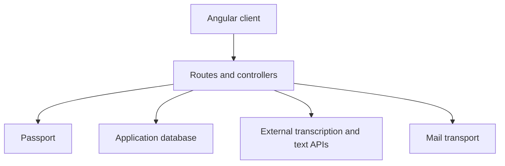

# MelioHealth — Healthcare workflow API

A Laravel 12 / PHP 8.2+ application prototype for account management, patient notes and audio-to-note integration. Paired client: [MelioHealth frontend](https://github.com/waleedmazhar64/meliohealth-frontend).

## What the code contains

| Area | Implementation |
| --- | --- |
| Registration, login, OTP and password recovery | [AuthController](app/Http/Controllers/AuthController.php) |
| Create, list, export and email patient notes | [NoteController](app/Http/Controllers/NoteController.php) |
| Profiles and audio transcription / SOAP-format draft generation | [ProfileController](app/Http/Controllers/ProfileController.php) |
| User and plan administration | [AdminController](app/Http/Controllers/AdminController.php) |
| API contract | [Route definitions](routes/api.php) |

Authentication uses Laravel Passport. The transcription flow calls external audio and text-generation APIs. The `AIstore` method stores supplied text; it is distinct from the transcription request. The transcription method currently returns generated text while its database-save block is commented out.

## Architecture



## Local setup

```bash
git clone https://github.com/waleedmazhar64/meliohealth-backend.git
cd meliohealth-backend
composer install
cp .env.example .env
php artisan key:generate
```

Configure a disposable database and local mail transport in `.env`. For local API authentication:

```bash
php artisan migrate
php artisan passport:keys
php artisan passport:client --personal
php artisan serve
```

Use the locked Composer dependencies. External AI calls require your own environment configuration and can incur provider charges. Account, note and integration flows need separate end-to-end verification.

## Representative routes

- `POST /api/register`, `POST /api/login`, `POST /api/verify-otp`
- `GET /api/notes`, `POST /api/notes`, `POST /api/ai-notes`
- `POST /api/transcribe`
- `GET /api/profile`, `POST /api/profile`

See [routes/api.php](routes/api.php) for all routes and declared middleware.

## Prototype boundaries

Use synthetic patient information only. This repository does not establish clinical validation, healthcare compliance or production readiness. Before deployment, address object-level authorisation, administrator restrictions and outbound TLS verification. The current card-storage workflow must not receive real payment-card data; replace it with a payment provider's tokenised integration before any real use.

The earlier README's appointment, Stripe and live-video claims did not match the inspected implementation and have been removed. Subscription records are not proof of payment processing. This documentation review did not execute the API, deploy it or verify the test suite.

## Author

[Waleed Mazhar — Senior Software Engineer](https://github.com/waleedmazhar64)
